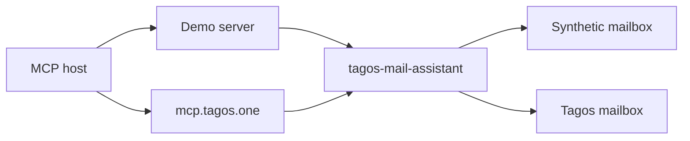

# Tagos Mail Assistant

Remembers who you are waiting on, briefs what changed, and saves a draft. It never sends mail.

Live in TagosMail at [mcp.tagos.one](https://mcp.tagos.one/mcp).

The demo video is part of the Devpost submission and is not in this repository yet.

MIT covers this library and demo only. TagosMail and mcp.tagos.one are proprietary services that use this library.

Privacy: https://tagos.one/privacy · Terms: https://tagos.one/terms (both returned 200 on 2026-10-04). The privacy page does not yet describe the assistant's reply-memory. That sentence is written with the core integration, before any deploy.

## Quickstart

No account is required.

```bash
cargo run --release -p tagos-mail-assistant-demo -- serve
```

Or, after `docker build -t tagos-mail-assistant .`:

```bash
docker run --rm -p 8787:8787 tagos-mail-assistant
```

The image listens on `0.0.0.0:8787` inside the container so the published port works. That bind is `--listen`, not `--public`. `--public` still requires demo login. The process writes `data/demo-followups.db` in its working directory. The image uses `/home/tagos`, which the `tagos` user can write. It builds with Rust 1.89 because the locked demo dependencies require that compiler.

Then open `http://127.0.0.1:8787/mcp`. `GET /mcp` is 405. `POST` speaks Streamable HTTP and returns JSON.

### stdio for Claude Desktop or Cursor

```json
{
  "mcpServers": {
    "tagos-mail-assistant": {
      "command": "cargo",
      "args": ["run", "--release", "-p", "tagos-mail-assistant-demo", "--", "stdio"]
    }
  }
}
```

### Inspector

```bash
npx @modelcontextprotocol/inspector@2.9.0 --cli \
  http://127.0.0.1:8787/mcp --method tools/list --format json
```

Demo login, for the Alexa+ profile and for Inspector OAuth:

```bash
cargo run -p tagos-mail-assistant-demo -- serve --auth-profile mcp --demo-static-token
```

`--auth-profile alexa` is the same login with a 401 that has no `WWW-Authenticate` header. `--demo-static-token` prints a loopback-only bearer on stderr. `scripts/oauth_inspector.sh` walks Inspector through the consent button in both profiles.

## Try this conversation

The mailbox clock starts at Monday 2026-10-19 08:00 America/New_York. Priya's reply is due Friday 18:00 local, which is 2026-10-23 22:00 UTC. Ninety-six clock hours land on Friday 08:00, still before that due time. Advance **107** hours to pass Friday 6pm.

1. "What changed?" → `inbox_briefing`. Priya is in the suggestion. The injection mail does not add an address.
2. "Watch Priya until Friday." → `await_reply` for Priya, due `2026-10-23`.
3. "And Sam." → `await_reply` for Sam. Two Sams, so nothing is created.
4. Advance the clock 107 hours (`demo_advance_clock`).
5. "Draft a nudge." → `prepare_reply_draft`. The note says nothing was sent.
6. Deliver Priya's reply (`demo_deliver_reply` scenario `priya_signed`) and `check_followups`. The followup closes once.

## Tools

| Tool | Scope in the demo login | Notes |
| --- | --- | --- |
| `whoami`, `search_messages`, `list_people`, `list_contexts`, `get_thread`, `list_drafts` | `mail.read` | Same names as the live server |
| `inbox_briefing`, `list_followups`, `check_followups` | `mail.read` | Assistant reads |
| `await_reply`, `resolve_followup`, `forget_followups`, `prepare_reply_draft` | `mail.draft` | Assistant writes memory or a draft |
| `update_draft`, `delete_draft` | `mail.draft` | Drafts only |
| `demo_advance_clock`, `demo_deliver_reply`, `demo_reset` | `mail.draft` | Demo only |

`get_thread` returns the oldest messages first. `limit` defaults to 20 and caps at 50. There is no cursor, so a thread longer than 50 hides the newest message. `search_messages` is a whitespace AND over words, not a label language.

No tool here sends mail. The live server still has its own `send_message` and `send_draft` under `mail.send`. This library does not call them.

## Architecture



One library. The demo adapts a synthetic mailbox. The closed TagosMail service adapts its own mailbox. The library has no send method and no HTTP client.

## Alexa+ compatibility

| Requirement | Demo | Live mcp.tagos.one | Test |
| --- | --- | --- | --- |
| Streamable HTTP, `GET /mcp` is 405 | yes | yes | `mcp::tests::initialize_on_2025_11_25_and_get_is_not_allowed` |
| Protocol 2025-11-25 | advertised | accepted, among others | same test |
| 401 without `WWW-Authenticate` | `--auth-profile alexa` | no — the live server sends the header, on purpose | `auth::tests::alexa_profile_unauthorized_omits_www_authenticate` |
| PRM, S256, `resource`, refresh on every token | demo login | live OAuth, unchanged by this repo | `docs/ALEXA_PROFILE.md` |
| Bearer only in the header | yes | yes | `auth::tests::bearer_in_query_is_unauthorized` |
| Round trip under 500 ms | `scripts/bench.sh` | not measured here | bench exits non-zero at 500 ms |
| Real Alexa+ | no | the live server is not an Alexa add-on | — |

## Security model

Draft only. Mail bodies are untrusted and are not instructions. A new recipient needs `confirm_new_recipient`. A verbatim quote over 500 characters is rejected. Memory stores an address, an optional thread id, a short subject in the user's words, due time, status, and a draft id. Closed rows older than 30 days are dropped. `forget_followups` with `confirm: true` wipes one account. See [docs/SECURITY_MODEL.md](docs/SECURITY_MODEL.md).

## Use your own mailbox

Implement `MailBackend` and `FollowupStore`. There is still no send method. [docs/INTEGRATING.md](docs/INTEGRATING.md).

## Limits

There is no Alexa+ device in this repository, and there is no `/sim` page in this release. A reminder is not a push. The ticker marks overdue and ends a snooze from stored rows, without reading mail. The next session's briefing or `list_followups` is what speaks that reminder, once. A simulator can poll `check_followups`; this tree does not include one. Reply detection runs only inside a tool call, and only if the last check was at least 60 seconds ago. Sender heuristics and the 50-message thread window can miss a reply. There is no GIF in the tree. The demo video is part of the Devpost submission and is not in this repository yet.

## Bench

`scripts/bench.sh` prints p50 and p95 in-process and fails if any p95 is 500 ms or more. On this machine, 2026-10-04, 40 samples:

| Tool | p50 | p95 |
| --- | --- | --- |
| whoami | 0.01 ms | 0.02 ms |
| list_people | 0.16 ms | 0.28 ms |
| list_contexts | 0.03 ms | 0.04 ms |
| get_thread | 0.06 ms | 0.08 ms |
| search_messages | 0.16 ms | 0.24 ms |
| list_drafts | 0.00 ms | 0.00 ms |
| inbox_briefing | 0.35 ms | 0.61 ms |
| list_followups | 0.09 ms | 0.14 ms |
| check_followups | 0.11 ms | 0.14 ms |
| await_reply | 0.30 ms | 0.51 ms |
| prepare_reply_draft | 0.06 ms | 0.14 ms |
| demo_advance_clock | 0.00 ms | 0.00 ms |
| demo_reset | 0.05 ms | 0.06 ms |

`update_draft`, `delete_draft`, `resolve_followup`, `forget_followups`, and `demo_deliver_reply` are covered by the functional tests. They need a fresh id, so they are not in this loop.

## Live server card

`https://mcp.tagos.one/mcp` is the Tagos Mail MCP endpoint. Scopes are `mail.read`, `mail.draft`, and `mail.send`. A host signs in with Tagos. The server does not return raw MIME and does not accept a bulk recipient list.

Claude or Cursor remote config:

```json
{
  "mcpServers": {
    "tagos-mail": {
      "url": "https://mcp.tagos.one/mcp"
    }
  }
}
```

Inspector:

```bash
npx @modelcontextprotocol/inspector@2.9.0 --cli https://mcp.tagos.one/mcp --method tools/list
```

That call returns 401 until you complete Tagos login. Registry metadata, not yet published, is in [registry/server.json](registry/server.json):

```json
{
  "name": "one.tagos/mail",
  "description": "Tagos Mail MCP. Read a mailbox, search it, and save drafts. Sign in with Tagos.",
  "remotes": [
    { "type": "streamable-http", "url": "https://mcp.tagos.one/mcp" }
  ]
}
```

## License

MIT. See [LICENSE](LICENSE).
