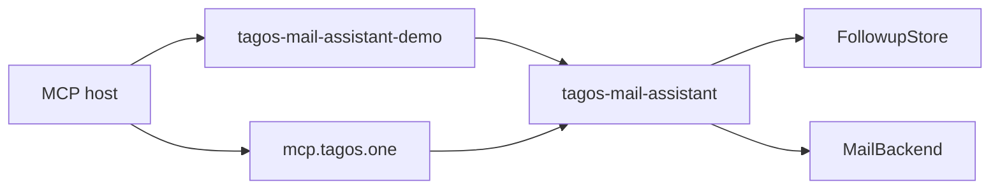

# Architecture

`tagos-mail-assistant` is a library. It does not open sockets, and `MailBackend` has no send method.

The demo binary supplies three adapters the library does not:

- `DemoMail`, a synthetic mailbox loaded from `demo/mailbox.json`
- `SqliteStore`, the followup memory for the demo process
- Streamable HTTP and stdio, via `rmcp`, plus an optional demo login

The closed TagosMail service is a second adapter. It is not in this repository. It will call the same library with the account id from the caller's token. It will not add a send method to the library.

Reply checks run inside `await_reply`, `list_followups`, and `check_followups`, and only when the last check is missing or at least 60 seconds old. A ticker can mark overdue and end a snooze from stored rows alone. It does not take a mailbox.

`get_thread` keeps the oldest prefix, at most 50 messages, and has no cursor.
